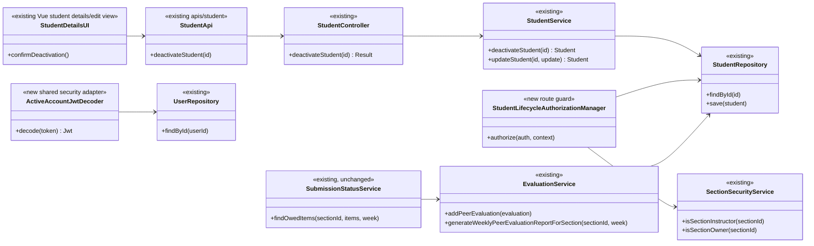

# Student (STU) Design

> Realizes: UC-STU-deactivate-student
> Depends on: FR-SEC-active-account; BR-student-lifecycle; BR-team-admin-only; BR-deactivated-student-evaluations; BR-submission-owed; BR-evaluation-editable-until-close; BR-section-scoped-access
> See: [use cases](../requirements/use-cases.md#student), [SRS](../requirements/software-requirements-specification.md), [architectural design](architectural-design.md) (Container/Component diagrams and authorization conventions).
> Design gate: Issue #1; implementation is deliberately not part of this document.

## Overview

STU already has `Student`, `StudentController`, `StudentService`, `StudentRepository`, a shared `enabled` account flag and `StudentDto.enabled`. Today the EditStudentForm generic PUT toggles that flag, but there is no dedicated action, warning, endpoint, or targeted verification. UC-STU-deactivate-student adds those pieces, preserves the existing student/team/work model, and closes two cross-area gaps: inactive evaluatees and already-issued JWT access. See the architecture-of-record's shared foundation and authorization sections; no parallel account table is introduced. Reactivation remains a separate use case.

## Components & classes



- **Frontend**: Existing student view/edit surface (`Students.vue` / `EditStudentForm.vue`) adds a dedicated Deactivate action for authorized actors, disabled or absent when `enabled=false`; use the existing `apis/student` request client. Show confirmation consequences from UC step 4. Cancel makes no network mutation. On 409/403/server error keep state and show accurate feedback. Remove the current status dropdown's silent ability to deactivate. Keep `StudentDto.enabled` readable for display but not a generic lifecycle write.
- **STU backend**: `StudentController` adds `PATCH /students/{studentId}/deactivate` returning `Result` with the updated `StudentDto` on success. `StudentService.deactivateStudent` loads the actual row, rejects already-inactive (409), sets `enabled=false`, saves transactionally, and does not mutate `team`, `section` or records. `StudentService.updateStudent` no longer changes `enabled` via the generic `PUT`, closing the silent bypass; this leaves reactivation as a separate unfinished UC, not something to implement here.
- **Authorization**: New `StudentLifecycleAuthorizationManager` reads `studentId` via `PathVariables`, loads the student fail-closed, checks the caller has an instructor/admin role, then checks the student's `sectionId` with `SectionSecurityService.isSectionInstructor` OR `isSectionOwner`. A different-section instructor, student, missing target, or missing/invalid claim is denied. It is not the existing `StudentInstructorAuthorizationManager` alone: that omits an owning course admin who is not assigned to the section.
- **Active account security (trunk first)**: Wrap Spring's signature/expiry-validating `NimbusJwtDecoder` with an account-aware `JwtDecoder` that looks up the verified JWT's `userId` in `UserRepository` for every bearer-token authentication and rejects missing/disabled accounts as invalid authentication (401). The existing Basic login uses `MyUserPrincipal.isEnabled`. Do not trust the UI, a stale JWT's role claim, or only the deactivation endpoint. Test both a just-disabled student and an unaffected active user; check this shared security change *before* feature code.
- **Evaluation (shared)**: `EvaluationService.addPeerEvaluation` rejects creation targeting a disabled evaluatee before saving; `updatePeerEvaluation` retains `BR-evaluation-editable-until-close` on previously stored rows. In `generateWeeklyPeerEvaluationReportForSection`, include active team members as today; include an inactive one only when `PeerEvaluationRepository.findByWeekAndEvaluateeId(week, id)` returns a stored evaluation. Do not synthesize future zero rows. `SubmissionStatusService.findOwedItems` already filters disabled students from reminders and from active teammate obligations, so keep and test it, do not clone its logic.

## Sequence

### UC-STU-deactivate-student: main success scenario

```mermaid
sequenceDiagram
    actor I as Course admin / section instructor
    participant UI as Student details (Vue)
    participant API as StudentController
    participant G as Lifecycle authorization manager
    participant S as StudentService
    participant DB as StudentRepository
    I->>UI: Open target student (steps 1-3)
    UI-->>I: Warning: access, team, history, reminders, ratings (step 4)
    I->>UI: Confirm (step 5)
    UI->>API: PATCH /students/{studentId}/deactivate
    API->>G: Route authorization (before controller)
    G->>DB: Find student, resolve section
    G-->>API: Authorized
    API->>S: deactivateStudent(studentId) (step 6)
    S->>DB: Find row and check enabled
    S->>DB: Save enabled=false (same transaction)
    DB-->>S: Saved student (membership unchanged)
    S-->>API: Student
    API-->>UI: 200 Result(updated StudentDto)
    UI-->>I: Success; refresh student status (steps 6-7)
```

### Extensions and already-issued credentials

```mermaid
sequenceDiagram
    actor I as Actor
    participant UI as Student details
    participant Guard as Security / authorization
    participant Service as StudentService
    participant DB as User/Student Repository
    alt 4a: cancel the warning
        I->>UI: Cancel
        UI-->>I: Close dialog, no API call
    else 2a: not this student's admin or assigned instructor
        UI->>Guard: PATCH deactivate
        Guard-->>UI: 403, no service mutation
    else 3a: stale UI, already inactive
        UI->>Service: PATCH via authorized guard
        Service->>DB: Read enabled=false
        Service-->>UI: 409, no write
    else 6a: persistence failure
        UI->>Service: PATCH via authorized guard
        Service-->>UI: Failure, transaction rolls back
    end
    opt Student reuses a validly signed JWT after deactivation
        I->>Guard: Protected request with old token
        Guard->>DB: Check JWT userId still enabled
        Guard-->>I: 401; do not execute protected endpoint
    end
```

## API contract

| Endpoint / path | Caller | Request | Success | Errors / extension |
|---|---|---|---|---|
| `PATCH /api/v1/students/{studentId}/deactivate` | Owning course admin **or** instructor assigned to student's course section, via new student-scoped lifecycle guard | Path `studentId`, no body | 200 `Result` with `StudentDto` (`enabled=false`); refresh UI | 2a: 403 for unauthorized or non-resolvable target (fail closed); 3a: 409 for already inactive; 6a: mapped 5xx/transaction rollback, no false success |
| `PUT /api/v1/students/{studentId}` (existing) | Existing user-ownership guard | Existing student profile body; ignore/reject status change | Updated profile, status unchanged | No new silent deactivation path; does not implement reactivation |
| `POST /api/v1/evaluations` (existing) | Existing evaluation authorization | Existing evaluation DTO | Existing successful behavior for active evaluatee | New invalid-argument rejection when evaluatee is inactive (BR-deactivated-student-evaluations) |
| `GET /api/v1/evaluations/sections/{sectionId}/week/{week}` (existing) | Existing section instructor access | Path values | Active members and inactive members with recorded evaluations for that week | Preserve historic scores and comments; inactive with none for requested week omitted |
| Protected bearer-token routes (shared) | Signed, unexpired JWT **and** DB account still enabled | JWT with validated `userId` | Existing normal role/ownership rules apply | 401 when user is disabled or nonexistent even for otherwise-valid unexpired JWT |

**Explicit security routing:** Add `.requestMatchers(HttpMethod.PATCH, this.baseUrl + "/students/{studentId}/deactivate").access(this.studentLifecycleAuthorizationManager)` **before** the `/api/**` deny-all catchall in `SecurityConfiguration`. This must not fall through to `authenticated()` or `userOwnershipAuthorizationManager`. The account-aware JWT check also applies before executing an arbitrary protected request; the main endpoint's authorization is a separate target-student check.

## Key decisions

1. **Keep membership, do not detach.** Chosen: `Student.team` / `Student.section` unchanged. Rejected: remove the student from her team, which is separately course-admin owned (BR-team-admin-only) and would change historical/team associations and reactivation behavior. A student can be inactive while still on a team.
2. **Constrain future evaluations, retain actual history.** Chosen: no new evaluations targeting disabled students, existing evaluations remain editable only during normal windows. Weekly instructor report includes disabled students only in weeks with recorded evaluations. Rejected: filtering disabled students from all reports (loses history) and including zero-score rows in future weeks (misleading). This avoids introducing deactivation timestamp/audit tables solely for this UC.
3. **Recheck state at the server.** Chosen: non-idempotent action returns 409 on already disabled target (3a) rather than reporting success. Rejected: relying on disabled UI action, which cannot protect stale tabs/races.
4. **Account check on every authenticated JWT request.** Chosen: validated JWT `userId` mapped to current persisted account state; 401 on disabled. Rejected: checking only `isEnabled` at Basic login or waiting for token expiry, both violate FR-SEC-active-account. Performance trade-off: one indexed account lookup per bearer request; keep it feature-neutral and review as the first shared/trunk commit.
5. **Dedicated state transition.** Chosen: PATCH with server-side lifecycle authorization and a separate confirmation; normal profile PUT may not change `enabled`. Rejected: reusing the generic edit PUT, which can silently flip status without the policy warning. Reactivation remains a follow-up use case, not a second endpoint in this build.
6. **Honor section and course boundaries.** Chosen: student-specific guard that admits either owning course admin or assigned section instructor. Rejected: any `ROLE_instructor` and the existing section-instructor-only manager; both diverge from BR-student-lifecycle.

## Data model

No new table or migration. `Student` already inherits `enabled` and keeps `team` / `section` links. `PeerEvaluation` records continue referencing evaluator and evaluatee; existing `PeerEvaluationRepository.findByWeekAndEvaluateeId` supplies the history-preserving report predicate. See the SRS Business Domain Model for the shared entities.

## Reuse & cross-cutting

Use the existing `Result` envelope, `StatusCode.CONFLICT` (409), exception mapping, `UserUtils`/JWT claims, `StudentSecurityService`/`SectionSecurityService`, and `StudentDto` conversion pattern. Basic login already has `MyUserPrincipal.isEnabled`; bearer-token lookup is the gap. Leave `SubmissionStatusService` as the single implementation of BR-submission-owed; its existing active filter needs regression tests, not copied rules.

**Trunk-first implementation pause:** Commit the shared bearer-account check and its isolated tests first. Review how it affects every bearer route (not just students). Then commit the evaluation changes and student-specific endpoint/UI as later leaves. Treat any contradiction with the spec as a new spec/design commit before proceeding.

## Tests

Each row names the expected oracle. Planned tests are **not yet executed**, and do not justify a verified trace state until actually run and reviewed.

| ID / Use case flow | Level | Oracle / assertions |
|---|---|---|
| STU-01 main (steps 1-7) | Integration + UI/manual | Confirmed authorized PATCH returns 200; enabled becomes false; UI shows consequences and success only after response |
| STU-02 unauthorized instructor (2a) | Integration | BR-student-lifecycle: other-section instructor cannot deactivate, gets 403, row unchanged |
| STU-03 unauthorized role / unknown target (2a) | Integration | BR-student-lifecycle: student caller and non-resolvable target fail closed, no mutation or leak |
| STU-04 already inactive (3a) | Integration + unit | UC extension 3a: 409, no write, UI cannot invoke action on known disabled account |
| STU-05 cancels at warning (4a) | Frontend/manual or UI test | UC extension 4a: no PATCH, no changed state |
| STU-06 persistence failure (6a) | Unit with repository failure | UC extension 6a: no success and transactional rollback/no partial write |
| STU-07 on a team | Integration | BR-student-lifecycle and BR-team-admin-only: student and section/team membership unchanged |
| STU-08 preserved work | Integration | BR-student-lifecycle: pre-existing weekly reports and peer evaluation records survive deactivation |
| STU-09 outstanding items and reminders | Integration / notification regression | BR-submission-owed: inactive student not reminded/owing; active teammates no longer owe her evaluation |
| STU-10 new evaluation targeting inactive | Unit + integration | BR-deactivated-student-evaluations: new create rejected even when same-team and week otherwise open |
| STU-11 existing evaluation edit | Unit/integration | BR-evaluation-editable-until-close: pre-existing evaluation remains editable in its window, never reopened after it |
| STU-12 past report with scores | Integration | BR-deactivated-student-evaluations: disabled student with stored evaluations remains visible for that week with stored values |
| STU-13 week without stored evaluations | Unit/integration | BR-deactivated-student-evaluations: inactive student omitted; active teammates still included |
| STU-14 new Basic login | Integration | FR-SEC-active-account: disabled account cannot get a new login |
| STU-15 stale JWT | Integration | FR-SEC-active-account: old validly signed token returns 401 after disabling, across a protected API route |
| STU-16 active JWT regression | Integration | Existing authentication: unrelated active users' JWTs and permitted routes still work |
| STU-17 generic PUT bypass | Integration | UC step 4 and BR-student-lifecycle: profile PUT cannot toggle enabled silently |

## Open questions / risks

- **Frontend test harness**: no existing frontend automated tests are traced for STU. If no harness is available, document exact manual browser cases for STU-01/04/05 in the build PR; mark them *not automated* in traceability, never invent a green test.
- **Mutable account status concurrency**: service checks the persisted status at request time; sequential tests must verify repeat submissions. If racing concurrent requests are not guarded, list as unverified or add a conditional update; do not assert atomicity without a test.
- **Cross-cutting authentication**: include both disabled student and disabled instructor tests, since FR-SEC-active-account covers both. Ensure 401 on stale token is actually demonstrated, not inferred from a service unit test.
